# DL Ideas – Simple Store

A web portal built with **CodeIgniter 3.1.13**, **PHP 7.3** and **MySQL 8.0**, with payments through **Stripe Checkout**. Created as a coding exercise submission to DL Ideas Singapore by Stanny Claus Mangamis

- **Admins** manage users and products, and view every invoice, receipt and Stripe payment.
- **Users** shop from a cart, pay on Stripe's hosted page, and get an invoice and receipt for every purchase.
- A **JSON API** lets apps sign in and read a user's invoices and receipts.

I structured the app the way I usually structure my Laravel applications with the adjustment to match that of the CodeIgniter way

---

## Table of contents

1. [Requirements](#1-requirements)
2. [Easy setup (Docker + make)](#2-easy-setup-docker--make)
3. [Setup with Docker, without make](#3-setup-with-docker-without-make)
4. [Setup without Docker](#4-setup-without-docker)
5. [Configuration (.env)](#5-configuration-env)
6. [Stripe setup](#6-stripe-setup)
   - [API keys](#61-api-keys)
   - [Webhooks](#62-webhooks)
   - [Test cards](#63-test-cards)
7. [Signing in](#7-signing-in)
8. [Makefile reference](#8-makefile-reference)
9. [Everyday commands](#9-everyday-commands)
10. [Troubleshooting](#10-troubleshooting)
11. [AI Usage](#11-ai-usage)
12. [ERD](#12-ERD)
13. [Further Explanation](#13-further-explanation)
14. [Screeenshoots](#12-screenshoots)
---

## 1. Requirements

| Setup | You need |
|---|---|
| [Easy setup](#2-easy-setup-docker--make) | Docker (with Docker Compose v2), `make`, Git |
| [Docker without make](#3-setup-with-docker-without-make) | Docker (with Docker Compose v2), Git |
| [Without Docker](#4-setup-without-docker) | PHP 7.3, Apache 2.4 (or nginx + PHP-FPM), MySQL 8.0, Composer 2, Git |

For every setup you also need a free **Stripe account** in test mode, see [Stripe setup](#6-stripe-setup).

> **Windows users:** run the commands below in **WSL (Ubuntu)** with Docker Desktop's WSL integration enabled. `make` is available there (`sudo apt install make`). Plain PowerShell has no `make`; use [Docker without make](#3-setup-with-docker-without-make) instead.

The Docker setup starts two containers:

| Container | What it runs | Reachable at |
|---|---|---|
| `app` | PHP 7.3 + Apache | <http://localhost:8090> |
| `db` | MySQL 8.0 | `localhost:3307` from your computer (e.g. DBeaver), `db:3306` from the app |

[↑ Back to top](#table-of-contents)

---

## 2. Easy setup (Docker + make)

**1. Clone the project**

```bash
git clone <repository-url> dl-ideas-task
cd dl-ideas-task
```

**2. Create your configuration**

```bash
cp .env.example .env
```

Open `.env` and fill in at least the Stripe keys. Everything else works with the defaults. See [Configuration](#5-configuration-env) and [Stripe setup](#6-stripe-setup).

> Database names and passwords are read **only the first time** the database container starts. Set them before step 3.

**3. Build and start the containers**

```bash
make build
```

The first run takes a few minutes (it builds the PHP 7.3 image and initialises MySQL).

**4. Install PHP packages** (Stripe SDK)

```bash
docker compose exec -u "$(id -u):$(id -g)" -e COMPOSER_HOME=/tmp/composer app composer install
```

**5. Make the writable folders writable**

```bash
mkdir -p application/cache/sessions public/uploads/avatars public/uploads/products
chmod -R 777 application/logs application/cache public/uploads
```

**6. Create the database tables and the admin account**

```bash
make migrate
make seed-admin
```

**7. Forward Stripe webhooks** (needed to mark orders as paid, see [Webhooks](#62-webhooks))

```bash
stripe listen --forward-to localhost:8090/stripe/webhook
```

**8. Open the app:** <http://localhost:8090>, then [sign in](#7-signing-in).

[↑ Back to top](#table-of-contents)

---

## 3. Setup with Docker, without make

Same steps as the [easy setup](#2-easy-setup-docker--make), with the plain Docker commands that the Makefile wraps:

```bash
# 1. Clone
git clone <repository-url> dl-ideas-task
cd dl-ideas-task

# 2. Configuration (then edit .env)
cp .env.example .env

# 3. Build and start
docker compose up -d --build

# 4. PHP packages
docker compose exec -u "$(id -u):$(id -g)" -e COMPOSER_HOME=/tmp/composer app composer install

# 5. Writable folders
mkdir -p application/cache/sessions public/uploads/avatars public/uploads/products
chmod -R 777 application/logs application/cache public/uploads

# 6. Tables + admin account
docker compose exec app php public/index.php migrate
docker compose exec app php public/index.php seed

# 7. Stripe webhooks
stripe listen --forward-to localhost:8090/stripe/webhook
```

> **PowerShell:** `$(id -u)` doesn't exist there. Leave out `-u "$(id -u):$(id -g)"` in step 4, and skip step 5 (Docker Desktop on Windows mounts folders as writable).

Then open <http://localhost:8090>.

[↑ Back to top](#table-of-contents)

---

## 4. Setup without Docker

### 4.1 Install the requirements

- **PHP 7.3** with the extensions `mysqli`, `curl`, `mbstring`, `json`, `fileinfo` and `zip`
- **Apache 2.4** with `mod_rewrite` (or nginx + PHP-FPM 7.3)
- **MySQL 8.0**
- **Composer 2**

### 4.2 Get the code and packages

```bash
git clone <repository-url> dl-ideas-task
cd dl-ideas-task
composer install
cp .env.example .env
```

### 4.3 Create the database

Log in to MySQL as root and run (change the password):

```sql
CREATE DATABASE dl_ideas CHARACTER SET utf8mb4 COLLATE utf8mb4_unicode_ci;
CREATE USER 'dl_ideas'@'localhost' IDENTIFIED WITH mysql_native_password BY 'change_me';
GRANT ALL PRIVILEGES ON dl_ideas.* TO 'dl_ideas'@'localhost';
FLUSH PRIVILEGES;
```

`mysql_native_password` is needed because PHP 7.3 can have trouble with MySQL 8's default login method.

In `.env`, set `DB_HOST=127.0.0.1`, `DB_PORT=3306` and the user, password and database name you just created.

### 4.4 Configure the web server

The web root must be the **`public/`** folder. Nothing outside it should be reachable from the browser.

The app reads its settings with `getenv()`. Without Docker, nothing loads `.env` automatically, so the values have to be passed to PHP by the web server.

**Apache** example virtual host:

```apache
<VirtualHost *:8090>
    DocumentRoot /path/to/dl-ideas-task/public

    <Directory /path/to/dl-ideas-task/public>
        AllowOverride All
        Require all granted
    </Directory>

    # Copy every line of your .env here as: SetEnv NAME value
    SetEnv CI_ENV development
    SetEnv APP_BASE_URL http://localhost:8090/
    SetEnv DB_HOST 127.0.0.1
    SetEnv DB_PORT 3306
    SetEnv DB_DATABASE dl_ideas
    SetEnv DB_USERNAME dl_ideas
    SetEnv DB_PASSWORD change_me
    SetEnv STRIPE_SECRET_KEY sk_test_...
    SetEnv STRIPE_PUBLISHABLE_KEY pk_test_...
    SetEnv STRIPE_WEBHOOK_SECRET whsec_...
    # ...and the remaining keys from .env
</VirtualHost>
```

Enable `mod_rewrite` (`sudo a2enmod rewrite`) and restart Apache. The `.htaccess` file in `public/` handles clean URLs.

**nginx:** send every request that isn't a file to `/index.php`, and pass each `.env` value with `fastcgi_param NAME value;`.

### 4.5 Writable folders

The web server user (often `www-data`) must be able to write to:

```bash
mkdir -p application/cache/sessions public/uploads/avatars public/uploads/products
sudo chown -R www-data:www-data application/logs application/cache public/uploads
```

### 4.6 Tables and admin account

Command-line PHP also needs the `.env` values, so load them into your shell first:

```bash
set -a; source .env; set +a
php public/index.php migrate
php public/index.php seed
```

> If a value in `.env` contains characters like `&`, `!`, `>` or spaces, wrap it in single quotes (`DB_PASSWORD='p&ss!word'`) before sourcing.

### 4.7 Webhooks and first visit

Forward Stripe webhooks (see [Webhooks](#62-webhooks)), then open <http://localhost:8090>.

[↑ Back to top](#table-of-contents)

---

## 5. Configuration (.env)

| Key | Example | Notes |
|---|---|---|
| `CI_ENV` | `development` | `development` shows errors; use `production` on a real server |
| `APP_BASE_URL` | `http://localhost:8090/` | Must end with `/`. Use your ngrok URL if you test from another device |
| `APP_ENCRYPTION_KEY` | output of `openssl rand -hex 32` | Used for sessions and encryption |
| `APP_CURRENCY` | `usd` | One currency for the whole shop |
| `DB_HOST` | `db` | `db` with Docker, `127.0.0.1` without |
| `DB_PORT` | `3306` | Port **inside** Docker, even though your computer uses 3307 |
| `DB_DATABASE` | `dl_ideas` | |
| `DB_USERNAME` | `dl_ideas` | |
| `DB_PASSWORD` | `change_me` | Avoid `$` (Docker Compose treats it as a variable) |
| `DB_ROOT_PASSWORD` | `change_me_root` | Docker only |
| `STRIPE_PUBLISHABLE_KEY` | `pk_test_...` | From the Stripe dashboard |
| `STRIPE_SECRET_KEY` | `sk_test_...` | From the Stripe dashboard. Checkout is disabled without it |
| `STRIPE_WEBHOOK_SECRET` | `whsec_...` | From `stripe listen` or the dashboard endpoint |
| `SEED_ADMIN_NAME` | `Administrator` | Used by the seeder |
| `SEED_ADMIN_EMAIL` | `admin@example.com` | Used by the seeder |
| `SEED_ADMIN_PASSWORD` | `admin12345` | Used by the seeder |

After changing `.env` with Docker, apply it with:

```bash
docker compose up -d
```

[↑ Back to top](#table-of-contents)

---

## 6. Stripe setup

### 6.1 API keys

1. Sign in to <https://dashboard.stripe.com> and make sure **Test mode** is on.
2. Open **Developers → API keys**.
3. Copy the **Publishable key** (`pk_test_...`) and the **Secret key** (`sk_test_...`) into `.env`.

### 6.2 Webhooks

Stripe tells the app that a payment succeeded through a **webhook**. Without it, orders stay "pending" until the success page checks Stripe directly.

**Option A: Stripe CLI (recommended for local testing)**

1. Install the [Stripe CLI](https://docs.stripe.com/stripe-cli) and run `stripe login`.
2. Start forwarding:

   ```bash
   stripe listen --forward-to localhost:8090/stripe/webhook
   ```

3. Copy the `whsec_...` value it prints into `STRIPE_WEBHOOK_SECRET` in `.env`, then run `docker compose up -d`.
4. Keep this terminal open while testing.

**Option B: ngrok + dashboard endpoint**

1. Expose the app: `ngrok http 8090`, and set `APP_BASE_URL` to the `https://...ngrok...` URL it shows.
2. In the Stripe dashboard, open **Developers → Webhooks → Add endpoint**, with the URL `https://<your-ngrok-url>/stripe/webhook`.
3. Select these events:
   - `checkout.session.completed`
   - `checkout.session.async_payment_succeeded`
   - `checkout.session.async_payment_failed`
   - `checkout.session.expired`
4. Copy the endpoint's **Signing secret** into `STRIPE_WEBHOOK_SECRET`.

### 6.3 Test cards

Use any future expiry date, any 3-digit CVC and any postcode.

| Card number | Result |
|---|---|
| `4242 4242 4242 4242` | Payment succeeds |
| `4000 0025 0000 3155` | Asks for 3-D Secure authentication |
| `4000 0000 0000 0002` | Card is declined |

[↑ Back to top](#table-of-contents)

---

## 7. Signing in

Open <http://localhost:8090/login>.

| Role | Email | Password |
|---|---|---|
| Admin | `admin@example.com` | `admin12345` |

These are the defaults. If you set `SEED_ADMIN_*` in `.env`, use those values instead.

Admins land on `/admin`. Create a **user** account from **Admin → Users**, add a few products in **Admin → Products**, then sign in as that user to shop.

[↑ Back to top](#table-of-contents)

---

## 8. Makefile reference

Run these from the project folder.

| Command | What it does |
|---|---|
| `make start` | Start the containers |
| `make stop` | Stop the containers (database data is kept) |
| `make build` | Rebuild the PHP image and start the containers |
| `make logs` | Follow the app container's logs |
| `make shell` | Open a shell inside the app container |
| `make migrate` | Run all pending database migrations |
| `make migrate-down` | Roll back **all** migrations (deletes all tables and data) |
| `make migration-version version=20261113180000` | Migrate up or down to a specific version |
| `make migration name=Create_example_table` | Create a new, empty migration file |
| `make seed-admin` | Create the admin account (skipped if it already exists) |

[↑ Back to top](#table-of-contents)

---

## 9. Everyday commands

| Task | Command |
|---|---|
| Install or update PHP packages | `docker compose exec -u "$(id -u):$(id -g)" -e COMPOSER_HOME=/tmp/composer app composer install` |
| Open a MySQL shell | `docker compose exec db mysql -u dl_ideas -p dl_ideas` |
| Rebuild the database from scratch | `make migrate-down && make migrate && make seed-admin` |
| Wipe the database **including** its volume | `docker compose down -v` (then start again from step 3) |
| Read application logs | `ls application/logs/` |

[↑ Back to top](#table-of-contents)

---

## 10. Troubleshooting

| Problem | Fix |
|---|---|
| `port is already allocated` | Port 8090 or 3307 is in use. Change the left-hand number of the port mapping in `docker-compose.yml`, and update `APP_BASE_URL` |
| Page shows a database connection error | Wait until `docker compose ps` shows `db` as **healthy** (first start takes a while). Check that `DB_HOST=db` |
| `Access denied for user` after changing DB credentials | MySQL keeps the credentials from its first start. Run `docker compose down -v` and start again (this deletes the data) |
| `The server requested authentication method unknown to the client` | The MySQL user isn't using `mysql_native_password` (see [4.3](#43-create-the-database)) |
| Unstyled pages or broken links | `APP_BASE_URL` doesn't match the address in your browser, or is missing the trailing `/` |
| Session or upload errors | The folders from step 5 aren't writable |
| `Class 'Stripe\StripeClient' not found` | The PHP packages aren't installed. Run step 4 |
| Order stays "pending" after paying | Webhooks aren't reaching the app. Check that `stripe listen` is running and `STRIPE_WEBHOOK_SECRET` matches |
| `apt-get update` fails while building | The PHP 7.3 image uses an old Debian release whose mirrors have moved. Point apt at `archive.debian.org` in `docker/php/Dockerfile` before `apt-get update` |

[↑ Back to top](#table-of-contents)


## 11. AI Usage
As instructed, the code is generated manually without AI coding assistance writing the code. But I wouldn't dare to claim that this code is 100% built wihout AI's help; Due to the fact that the last time I touched CodeIgniter is back in 2011 with CodeIgniter version 1, hence I have to do a lot of documentation research and googling around to get myself updated with the requested version of CodeIgniter on this project (And to be honest, I already forgot a lot of CI MVC structure, and need to refresh my knowledge base). Few years ago, googling on code references usually meant I'll be spending hours scouring official docs and stackoverflow for code examples, but nowadays I can't  help it that by default when I search something on Chrome, Gemini will give a quick answer and most of the time with the code examples included. This is the point that makes me wouldn't be able to say that there's no AI assistance at all when I was building this app.
[↑ Back to top](#table-of-contents)


## 12. ERD
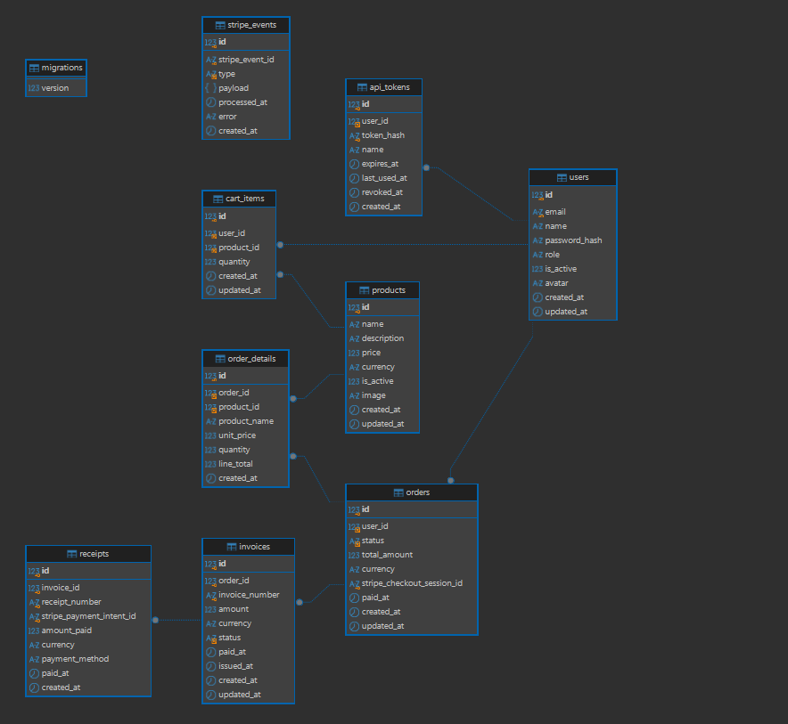
---
[↑ Back to top](#table-of-contents)


## 13. Further Explanation
* Further enchancements to ensure <strong>system users can perform a certain task only within the web application</strong> can be done from multiple angle including further refinement of the authorization system; where instead of just simple role 'user' and 'admin' that is stored inside database column, and based on the fact that the system also provides API endpoints, the enhancement can include limiting the scope of API tokens where certain abilities by users is not issued to API tokens hence can only be done inside the web application.
* The biggest concern in implementing API for mobile application using this system is the lack of support from the framework itself in handling JSON data, hance all custom parsers needs to be developed in order to handle request bodies for all the API endpoints that accept request body. All API related attributes needs to be manually developed or implemented using third party libraries including but not limited to JWT support, rate limiting and CORS handling. Error handling also needs to be enhanced so the error output format can be separated between normal browser requests and API requests. The biggest concern of all for me is the fact that PHP7.3 already reached end of life, so there will be no further security fixes including regarding the infamous recently discovered PHP2Shell invulnerability.
* On deployment strategy, I would prefer to deploy in docker container both in staging and production environment, for easy deployment management. I would switch the session handling using redis especially on production environment so it can be run on multiple instance behind load balancer and makes it easier for horizontal scalling in case the userbase grows. For cost optimization without neglecting performance especially during traffic spikes I would use container orchrestation such as kubernetes, AWS EKS, or Docker Swarm. This way the number of pods can be automatically increased during high usage, and decreased during low usage to save cost on infrastructure.
* Tools that I use for development is just docker and make. I use make it easier for me when running frequently used commands including creating files (especially db migrations) derived from my habbit of using artisan when working with Laravel.
[↑ Back to top](#table-of-contents)


## 14. Screenshoots

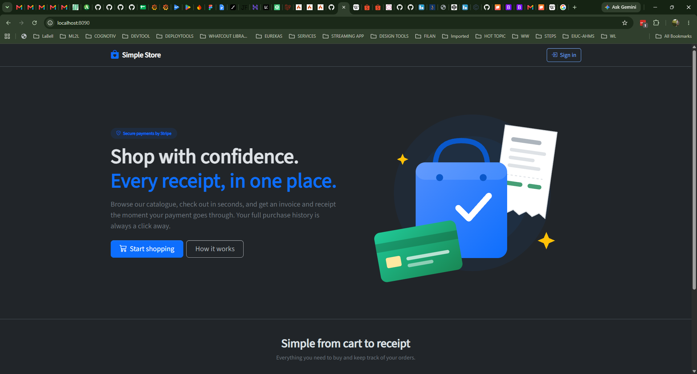
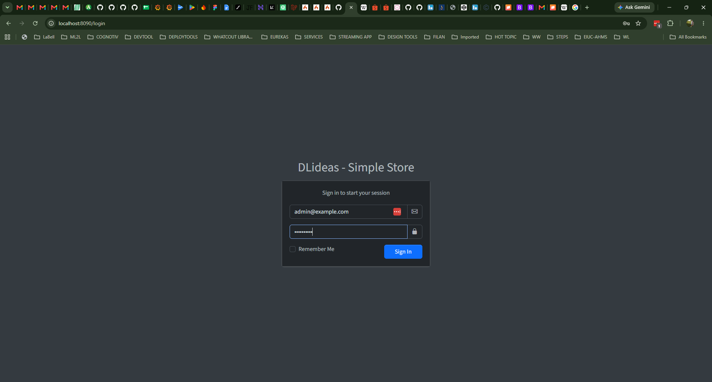
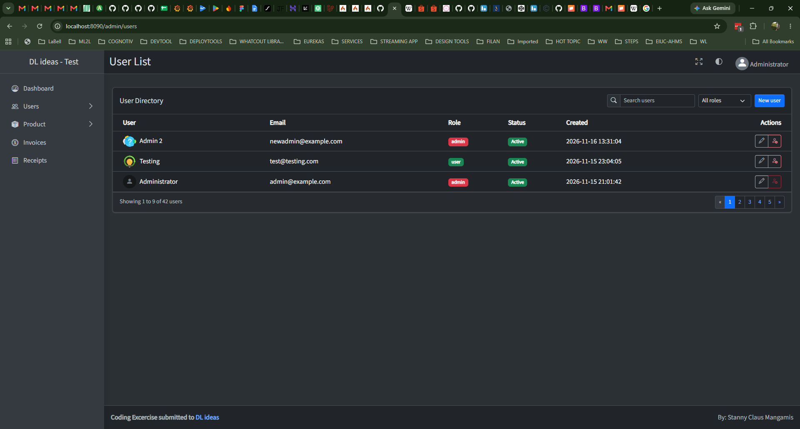
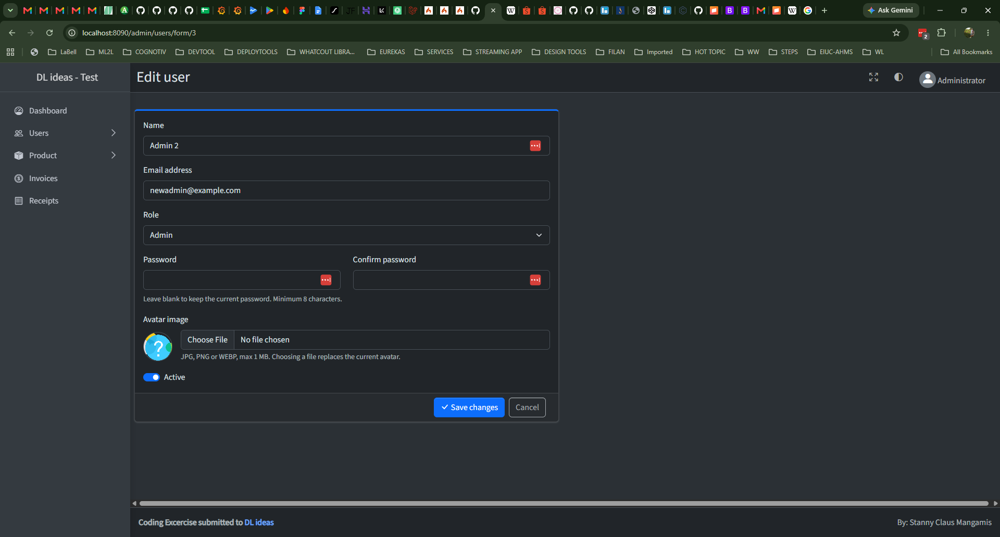

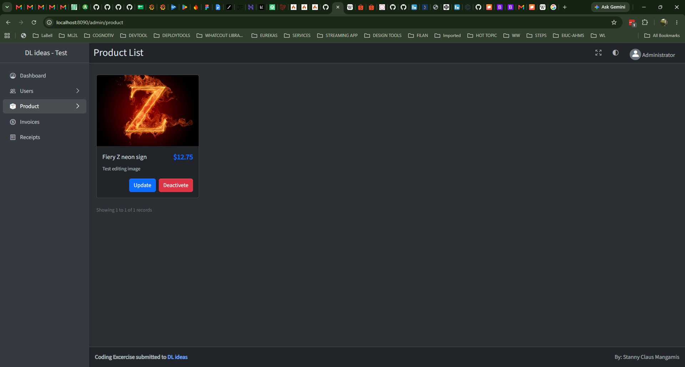
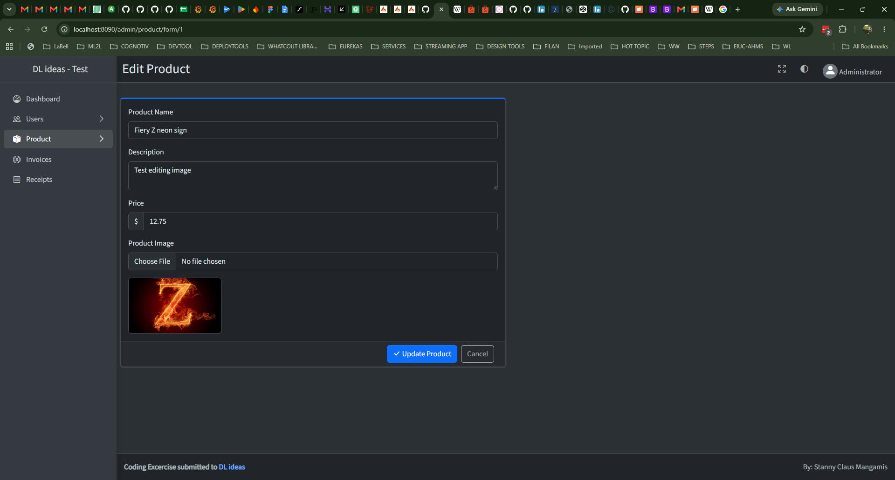
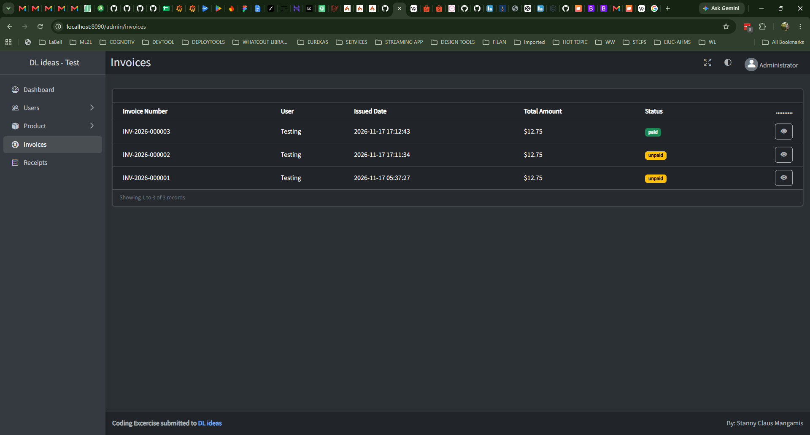
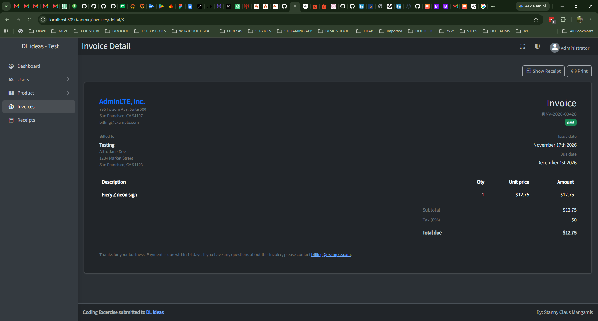
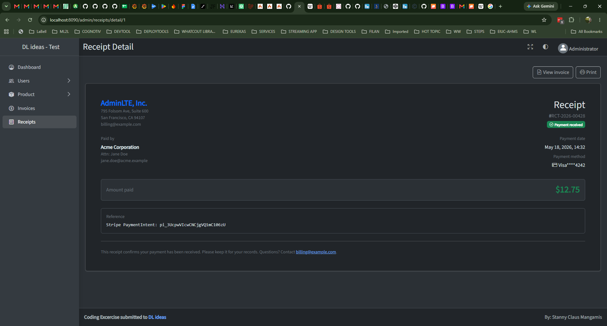
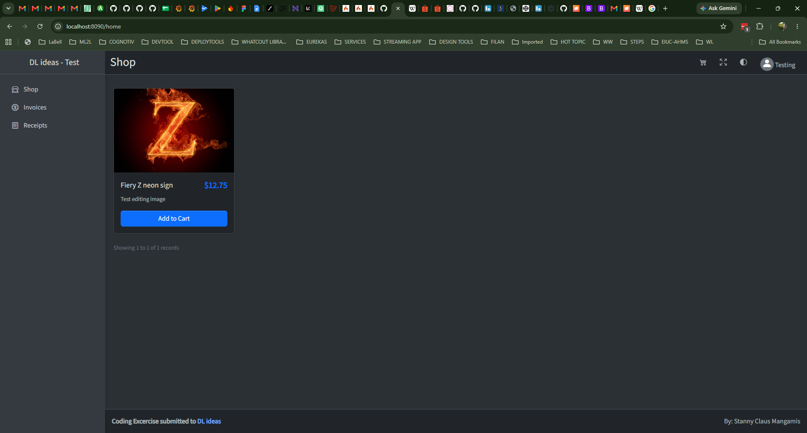


---

[↑ Back to top](#table-of-contents)

